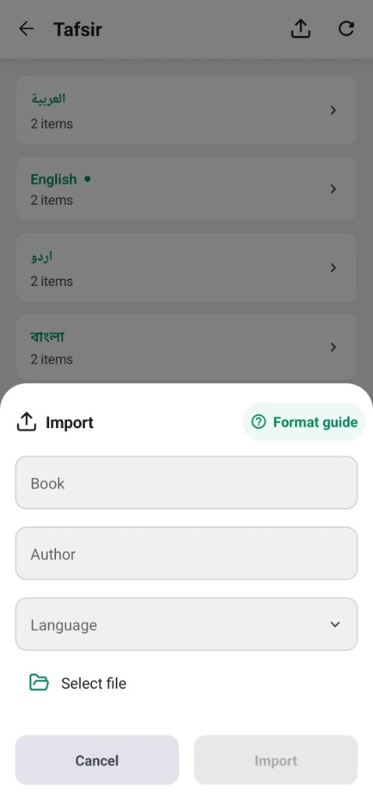

# Import a custom tafsir

- Turn on **Developer mode** in **Settings → Advanced settings**.
- Open **Settings → Tafsirs**.
- Choose **Import**.
- Enter the book name, author, and language.
- Choose a JSON file.
- Importing the same book again replaces the copy already on the device.



The file is a JSON object with a `tafsirs` array. Each item is one passage. A passage covers one verse, or several verses in a row. Surah An-Nas is one passage for 114:1 through 114:6:

```json
{
  "tafsirs": [
    {
      "verse_key": "114:1",
      "verses": ["114:1", "114:2", "114:3", "114:4", "114:5", "114:6"],
      "text": "<h2>Which was revealed in Makkah</h2><p>In the Name of Allah, the Most Gracious, the Most Merciful.</p>"
    }
  ]
}
```

## Fields

- `tafsirs` is the list of passages.
- `verses` lists every verse that passage comments on. Write each verse as its own string, such as `"114:1"`. `"114:1-6"` and `"114:1,114:2"` are not verse keys.
- `verse_key` names the passage, and it must be one of the verses in that passage. In the example above, `"114:1"` names a passage that also includes 114:2 through 114:6. Every passage needs its own `verse_key`.
- `text` is the commentary, written as HTML.

## Several verses

A passage for 3:7 through 3:9 is still one block. `verse_key` may be any of those three verses:

```json
{
  "tafsirs": [
    {
      "verse_key": "3:7",
      "verses": ["3:7", "3:8", "3:9"],
      "text": "<p>These three verses are read together.</p>"
    }
  ]
}
```

Opening any verse in that span shows the same passage, with a note that it covers more than one verse.

The verses in a passage are a continuous span of one chapter. `3:7`, `3:8`, and `3:9` belong together. `3:7` and `3:9` do not, because 3:8 is missing. List each verse once. A verse belongs to only one passage. When a book comments on the same verse in two places, give each place its own span and keep those spans from sharing a verse. [The German tafsir discussion](https://github.com/AlfaazPlus/QuranApp/issues/584) follows that case.

Chapters run from 1 to 114, and a verse must exist in its chapter. The file may cover any part of the Qur'an. A chapter with no passage is left without this tafsir.

## Commentary

Keep the markup small. `<p>`, `<h2>`, and `<strong>` are enough for most books. Many other tags work as well, including headings, lists, links, and `<hr>`.

To set Arabic in the Uthmani script, wrap that text in `<div class="arabic uthmani">بِسْمِ اللَّهِ</div>`.

## Escaping

Escape the commentary for HTML and for JSON. In the HTML, write `&amp;` for `&` and `&lt;` for a literal `<`. In the JSON string, write `\"` for a quote and `\\` for a backslash:

```json
"text": "<p>A note: A &amp; B.</p>"
```
