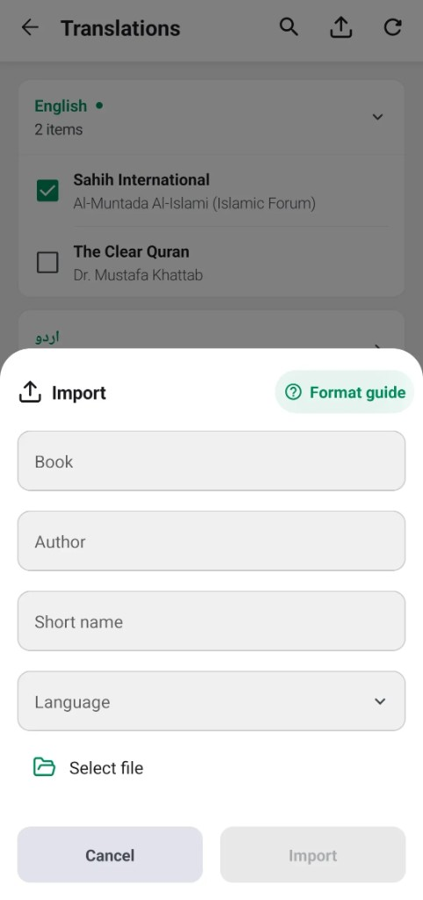

# Import a custom translation

Turn on **Developer mode** in **Settings → Advanced settings**. Then open **Settings → Translations** and choose **Import**. Enter the book name, author, display name, and language, and choose a JSON file. Importing the same book and language again replaces that translation.



The file is a UTF-8 JSON object with a `suras` array. Each chapter has an `index` and an `ayas` array. Each verse has an `index` and a `translation`. The files in [inventory/translations](/inventory/translations) are full examples of this shape. A short file looks like this:

```json
{
  "suras": [
    {
      "index": 1,
      "ayas": [
        {
          "index": 1,
          "translation": "In the name of Allah, the Beneficent, the Merciful."
        }
      ]
    }
  ]
}
```

## Fields

- `suras` is the list of chapters. Include at least one. A chapter `index` runs from 1 to 114, and each chapter appears once. An `index` may be a number or a numeric string such as `"2"`.
- `ayas` is the list of verses in that chapter. The list may be empty.
- A verse `index` runs from 1 to 286, and each verse appears once in its chapter.
- `translation` is the verse text. It may be an empty string.

A verse left out of the file stays blank. The file must be 20 MB or smaller.

## Footnotes

Footnotes are optional. When a verse has them, `footnotes` is an array. Each footnote has a positive `index`, unique within that verse, and a `text` string, which may be empty. Mark the footnote in the verse with `<fn>`:

```json
{
  "suras": [
    {
      "index": 1,
      "ayas": [
        {
          "index": 2,
          "translation": "All praise is for Allah.<fn index=\"1\">1</fn>",
          "footnotes": [
            {
              "index": 1,
              "text": "A short note. See <reference chapter=\"2\" verses=\"255\">2:255</reference>."
            }
          ]
        }
      ]
    }
  ]
}
```

## Markup

`translation` and footnote `text` use the same markup. The only tags are `<fn>` and `<reference>`, and every tag must be closed.

- `<fn index="1">` needs a positive `index`.
- `<reference chapter="2" verses="255">` needs a positive `chapter`. `verses` is optional. When present, it is a single number (`12`), a range (`12-15`), or a list (`12,15,18-20`).

## Escaping

In the text, a `<` or `&` must belong to a tag or to an escape such as `&amp;` or `&#39;`. In the JSON string, write `\"` for a quote and `\\` for a backslash:

```json
"translation": "A note: A &amp; B."
```
